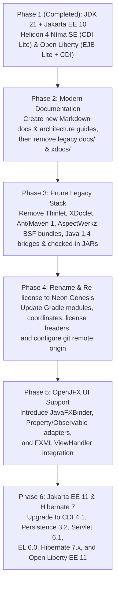

# Neon Genesis — Modernization & Architecture Roadmap

- **Project Name**: **Neon Genesis** (`neon-genesis`)
- **Author / Maintainer**: Leandro Cardoso de Andrade (`@kyogoiano` — `leandro.ueg@gmail.com`)
- **Repository**: `https://github.com/kyogoiano/neon-genesis.git`
- **Target Stack**: Java 21–25+ · Gradle 9.8.2+ · AspectJ 1.9.22+ · Jakarta EE 10/11 (Core Profile on Helidon 4 Níma SE + CDI Lite & Web Profile on Open Liberty + EJB Lite + CDI) · OpenJFX 21+

---

## Roadmap Phases

---

## 1. Documentation Modernization (Create New Docs Before Deleting Legacy Docs)

### New Markdown Documentation Suite
1. `README.md` — Project overview, architecture diagram, module guide, and Gradle build/test instructions.
2. `docs/architecture.md` — Core MVVM/MVC metadata (`@Form`, `@ViewHandler`, `FormController`) and AspectJ post-compile weaving architecture.
3. `docs/annotations-and-binding.md` — Reference for `@Form`, `@ViewHandler`, `@Action`, `@DataProvider`, `@Condition`, `@EnabledWhen`, `@VisibleWhen`, `@ClearOn`, `@CallWhen`, `@ValidateBefore`, and scripting engines (Jakarta EL, JSR-223, JXPath).
4. `docs/server-profiles.md` — Dual Jakarta EE profile guide:
   - **Core Profile**: Helidon 4 Níma SE + CDI Lite (`CommandExecutorCDI`, `CDIHibernateTransactionalInjector`, `HelidonCommandServer`/`HelidonCommandClient`).
   - **Web Profile**: Open Liberty + EJB Lite 4.0 + CDI (`CommandExecutorEJB`, `CommandExecutorLocal`).
5. `docs/persistence-and-criteria.md` — Hibernate 6/7 integration, `@Transactional`, `@Remotable`, `@Criteria` dynamic queries, and paging (`QueryPager`).

### Legacy Documentation to Remove Afterwards
- `docs/en/**`, `docs/pt-BR/**`, `docs/cobertura/**`, `docs/eclipse/**`, `docs/images/**`, `docs/tags/**`, `docs/*.html`, `docs/*.gif`, `docs/*.bmp`
- `genesis/xdocs/**` and `modules/*/xdocs/**`
- `genesis/BUILD-INSTRUCTIONS.txt` (consolidated into `README.md` and `docs/`)

---

## 2. Remove Thinlet & Legacy Features

- **Thinlet UI Support**:
  - `modules/client/src/net/java/dev/genesis/ui/thinlet/**`
  - `modules/aspect/src/net/java/dev/genesis/aspect/ThinletMetadataFactoryAspect.java`
  - `modules/aspect/src/net/java/dev/genesis/aspect/WaitCursorAspect.java`
  - `modules/client/test-src/net/java/dev/genesis/ui/thinlet/**`
  - `modules/tests/src/net/java/dev/genesis/tests/thinlet/**`
  - `net.sourceforge.thinlet:thinlet` dependency and Thinlet JAR AspectJ weaving in `genesis/build.gradle`.
- **Legacy Code Generation & Build Files**:
  - `xdoclet/**`, `xdoclet-genesis-modules/**`, `ant-tasks/**`
  - `genesis/build.xml`, `genesis/master_build.xml`, `genesis/desktop_build.xml`, `genesis/web_build.xml`, `genesis/build_dist.xml`, `genesis/build.properties*`, `genesis/project.xml`, `genesis/maven.xml`, `genesis/project.properties`, `genesis/clover.license`
  - `samples/**` (legacy Ant/WebStart sample projects)
  - `genesis/lib/**` (checked-in legacy 2004–2008 JARs; internalize or replace `reusable-components`)
- **Obsolete Modules & Bridges**:
  - `modules/container/**` and `modules/i18n/**`
  - `modules/client/src/net/java/dev/genesis/script/bsf/**`
  - `modules/client/src/net/java/dev/genesis/script/javaxscript/bridge/**` (replace JDK 1.4 reflection bridge with direct `javax.script.*` from `java.scripting`)

---

## 3. Rename to `neon-genesis`, Re-license & Configure Git Remote

- Rename Gradle root project to `neon-genesis` and artifacts to `neon-genesis-*`.
- Update license headers and `LICENSE.txt` with fork author metadata (**Leandro Cardoso de Andrade — `@kyogoiano` `<leandro.ueg@gmail.com>`**).
- Point Git remote `origin` to `https://github.com/kyogoiano/neon-genesis.git`.

---

## 4. OpenJFX Support & Jakarta EE 11 Migration

- **OpenJFX 21+ (`ui.javafx`)**:
  - Add `org.openjfx:javafx-controls` and `org.openjfx:javafx-fxml`.
  - Implement `JavaFXBinder` (`AbstractBinder` implementation for JavaFX `Node`, `TextInputControl`, `ComboBox`, `ListView`, `TableView`, `CheckBox`, `ToggleButton`, `ButtonBase`, and FXML controllers).
- **Jakarta EE 11 & Hibernate 7.x**:
  - Upgrade to Jakarta CDI 4.1 (Weld 6), Jakarta Persistence 3.2 (Hibernate 7.0.x), Jakarta Servlet 6.1, Jakarta EL 6.0 (Expressly 6), and Open Liberty Web Profile 11.
