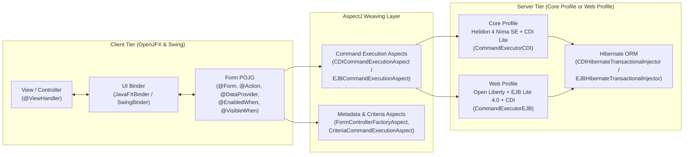

# Neon Genesis

**Neon Genesis** (`dev.neongenesis`) is a declarative Java UI binding and transactional command execution framework for **Java 21+**, **OpenJFX / Swing**, and **Jakarta EE 11**.

Originally forked from the Summa Genesis framework, **Neon Genesis** modernizes the entire stack around:
- **Java 21–25+** & **AspectJ 1.9.25+** post-compile weaving
- **OpenJFX 21+** (`JavaFXBinder`) and **Swing** (`SwingBinder`) rich-client UI binding
- **Dual Jakarta EE 11 Server Profiles**:
  - **Core Profile**: **Helidon 4 Níma SE** (virtual threads) + **CDI 4.1 Lite** (Weld SE 6)
  - **Web Profile**: **Open Liberty 26+** (`webProfile-11.0`) + **EJB Lite 4.0** + **CDI 4.1**
- **Hibernate ORM 7** (`jakarta.persistence` 3.2), declarative `@Transactional` / `@Remotable` commands, `@Criteria` dynamic queries, and paging

---

## Architecture Overview



---

## Modules

| Module | Artifact | Description |
| :--- | :--- | :--- |
| `:annotation` | `neon-genesis-annotation` | Declarative annotations (`@Form`, `@ViewHandler`, `@Action`, `@DataProvider`, `@EnabledWhen`, `@VisibleWhen`, `@Transactional`, `@Remotable`, `@Criteria`, etc.) |
| `:shared` | `neon-genesis-shared` | Shared command contracts (`Command`, `Query`, `Transaction`, `TransactionalInjector`), Hibernate integration (`AbstractHibernateCommand`, `QueryPager`), and utilities |
| `:client` | `neon-genesis-client` | Client metadata, `FormController`, scripting engines (`EL`, `javax.script` Rhino/BeanShell, `JXPath`), `SwingBinder`, and `JavaFXBinder` |
| `:server` | `neon-genesis-server` | Server executors (`CommandExecutorCDI`, `CommandExecutorEJB`, `CommandExecutorLocal`), `CDIHibernateTransactionalInjector`, and Helidon 4 Níma `HelidonCommandServer`/`HelidonCommandClient` |
| `:aspect` | `neon-genesis-aspect` | AspectJ aspects for metadata introduction, `FormController` lifecycle, `@Criteria` query resolution, and CDI/EJB command execution |
| `:tests` | — | Core Profile (Helidon 4 Níma SE + CDI Lite) and Web Profile (EJB Lite 4.0 + CDI) integration test suites |

---

## Building & Running Tests

Build with **JDK 21** or newer:

```bash
# Compile, weave AspectJ aspects, and run all checks
./gradlew build

# Run client unit tests (Swing & OpenJFX)
./gradlew :client:test

# Run Core Profile integration tests (Helidon 4 Níma SE + CDI Lite)
./gradlew :tests:integrationTest

# Run Web Profile integration tests (EJB Lite 4.0 + CDI)
./gradlew :tests:webProfileIntegrationTest
```

---

## Documentation Guides

- [Architecture & AspectJ Weaving](docs/architecture.md)
- [Declarative Annotations, Scripting & UI Binding (OpenJFX & Swing)](docs/annotations-and-binding.md)
- [Server Profiles: Core Profile (Helidon 4 Níma + CDI Lite) & Web Profile (Open Liberty + EJB Lite + CDI)](docs/server-profiles.md)
- [Persistence, Transactions, Dynamic `@Criteria` & Paging](docs/persistence-and-criteria.md)
- [Modernization Roadmap](NEON_GENESIS_ROADMAP.md)

---

## License

Licensed under the **Apache License, Version 2.0**. See [LICENSE](LICENSE) and [NOTICE](NOTICE) for details.
