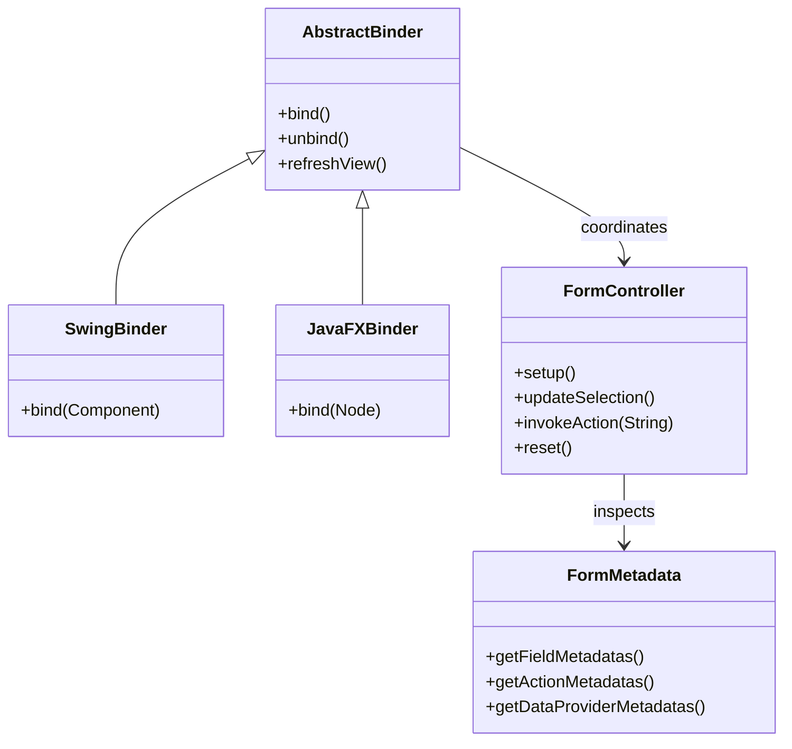

# Neon Genesis Architecture & AspectJ Weaving

Neon Genesis separates presentation (`@ViewHandler`), UI state and behavior (`@Form`), and transactional persistence (`@Transactional`, `@Remotable`, `@Criteria`) using declarative annotations and AspectJ post-compile weaving.

---

## 1. Core Architectural Layers

### Form (`@Form`)
A `@Form` class is a standard JavaBean representing the state, conditions, data providers, and actions of a screen:
- **Properties**: Bound two-way to UI widgets by name/id.
- **Conditions (`@Condition`, `@EnabledWhen`, `@VisibleWhen`)**: Scripted expressions (Jakarta EL, JavaScript/Rhino, BeanShell, or JXPath) evaluated automatically whenever form properties change.
- **Data Providers (`@DataProvider`)**: Methods that populate `ComboBox`, `ListView`/`JList`, or `TableView`/`JTable` components and synchronize selection back to a form property.
- **Actions (`@Action`)**: Methods triggered by buttons or lifecycle events (`@CallWhen`), optionally guarded by `@ValidateBefore`.

### View (`@ViewHandler`)
A `@ViewHandler` class represents the UI container (a JavaFX `Parent`/FXML controller or a Swing `Container`/`JFrame`/`JPanel`).

### Binder (`JavaFXBinder` / `SwingBinder`)
The binder connects a `@ViewHandler` widget hierarchy to a `@Form` instance by matching widget names/IDs (`Node#getId()` in JavaFX or `Component#getName()` in Swing) to form properties, `@DataProvider` methods, and `@Action` methods.

---

## 2. AspectJ Post-Compile Weaving

Neon Genesis uses AspectJ (`org.aspectj:aspectjtools`) during the Gradle build (`weaveAspectJ` task) to introduce metadata factories and intercept command invocations without requiring runtime bytecode agents:

| Aspect | Purpose |
| :--- | :--- |
| `FormMetadataFactoryAspect` | Mixes `FormMetadataFactory` into `@Form` classes to build and cache `FormMetadata`. |
| `FormControllerFactoryAspect` | Mixes `FormControllerFactory` into `@Form` classes to manage the `FormController` instance. |
| `ViewMetadataFactoryAspect` | Mixes `ViewMetadataFactory` into `@ViewHandler` classes to build and cache `ViewMetadata`. |
| `CriteriaCommandExecutionAspect` | Intercepts `@Criteria` methods on `HibernateCriteria` subclasses and builds dynamic JPA/Hibernate queries from form properties. |
| `CDICommandExecutionAspect` | Intercepts `@Remotable` and `@Transactional` methods in Core Profile, routing them to `CommandExecutorCDI` (in-process or over Helidon 4 Níma HTTP). |
| `EJBCommandExecutionAspect` | Intercepts `@Remotable` and `@Transactional` methods in Web Profile, routing them to `CommandExecutorEJB` (`CommandExecutorLocal`). |
