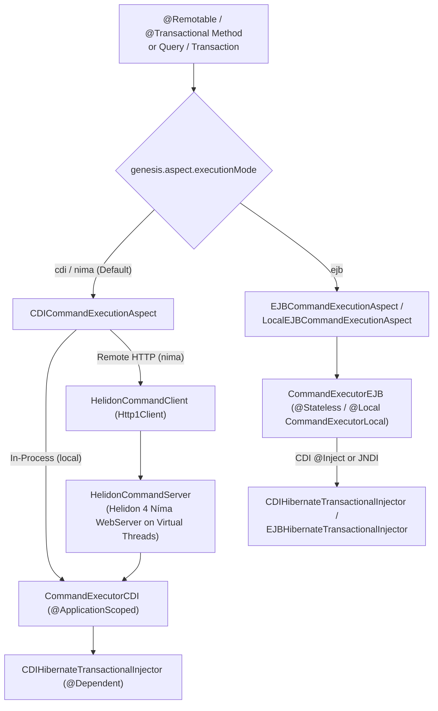

# Server Profiles: Core Profile & Web Profile

Neon Genesis supports two Jakarta EE execution profiles out of the box:



---

## 1. Jakarta EE Core Profile (Helidon 4 Níma SE + CDI Lite)

Designed for lightweight, cloud-native, and standalone SE deployments using **Java 21 virtual threads**:
- **CDI Bean**: `dev.neongenesis.cdi.CommandExecutorCDI` (`@ApplicationScoped`) implements `CommandExecutor`.
- **Transactional Injector**: `dev.neongenesis.cdi.hibernate.CDIHibernateTransactionalInjector` (`@Dependent`) opens a Hibernate `Session` per command invocation and manages transaction commit/rollback.
- **Execution Transports**:
  1. **In-Process CDI Lite**: Resolves `CommandExecutorCDI` directly via `CDI.current().select(CommandExecutorCDI.class).get()`.
  2. **Remote HTTP over Helidon 4 Níma**: `HelidonCommandServer` exposes `POST /genesis/command` and `GET /genesis/health` on Helidon 4 Níma `WebServer`, while `HelidonCommandClient` dispatches serialized commands over HTTP/1.1.

### System Properties (Core Profile)
| Property | Values | Description |
| :--- | :--- | :--- |
| `genesis.aspect.executionMode` | `cdi` (default) / `nima` | Enables `CDICommandExecutionAspect`. |
| `genesis.aspect.nima.url` | `http://host:port/genesis/command` | Configures the remote Helidon 4 Níma endpoint URL. |
| `genesis.aspect.cdiTransport` | `auto` / `local` / `remote` | Forces in-process CDI Lite (`local`) or HTTP Níma (`remote`). |
| `genesis.cdi.transactionalInjector` | Class name | Optional custom `TransactionalInjector` implementation class. |

---

## 2. Jakarta EE Web Profile (Open Liberty + EJB Lite 4.0 + CDI)

Designed for Jakarta EE Web Profile application servers such as **Open Liberty** (`webProfile-10.0` / `webProfile-11.0`):
- **EJB Lite 4.0 Bean**: `dev.neongenesis.ejb.CommandExecutorEJB` (`@Stateless(name = "CommandExecutor")`, `@Local(CommandExecutorLocal.class)`).
- **CDI + EJB Coexistence**: `META-INF/beans.xml` activates CDI beans alongside EJB Lite beans. `CommandExecutorEJB` supports `@Inject Instance<TransactionalInjector>` so CDI-managed injectors (`CDIHibernateTransactionalInjector`) work seamlessly with EJB Container-Managed Transactions (`@TransactionAttribute`), with fallback to JNDI `java:comp/env/TransactionalInjector`.

### Open Liberty `server.xml` Features
```xml
<server description="Neon Genesis Jakarta EE Web Profile Server">
   <featureManager>
      <feature>webProfile-10.0</feature>
      <feature>ejbLite-4.0</feature>
      <feature>cdi-4.0</feature>
      <feature>persistence-3.1</feature>
      <feature>servlet-6.0</feature>
   </featureManager>
</server>
```
